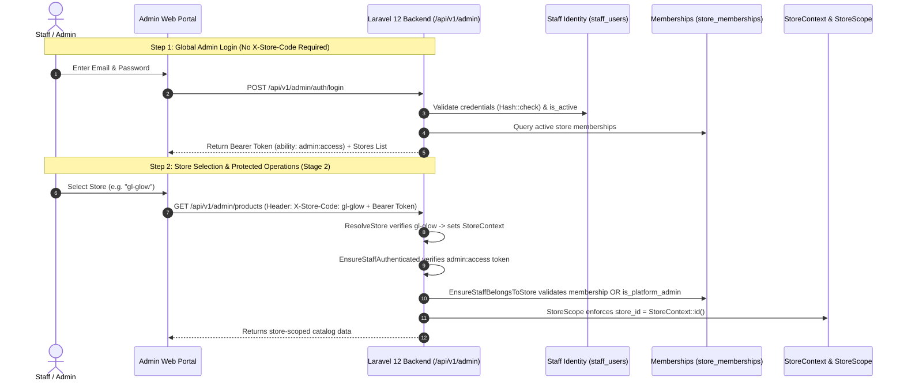

# Global Staff Authentication & Store Membership Architecture

> **Module**: Admin Panel Foundation (Stage 1)  
> **API Version**: `v1`  
> **Status**: Implementation Ready (Migrations Prepared, Not Executed)  
> **Target Audience**: Backend Engineers & Frontend Admin Portal Developers  

---

## 1. Architectural Overview & Workflow

The platform adopts a decoupled, multi-tenant administrative authentication model:

$$\text{Global Staff Login} \longrightarrow \text{Authorized Store Selection} \longrightarrow \text{Store-Scoped Admin Operations}$$



---

## 2. Separate Identity Model: Staff vs. Customers

To protect customer privacy and maintain strict tenant isolation:

| Attribute | Store Customers (`users`) | Administrative Staff (`staff_users`) |
|---|---|---|
| **Table** | `users` | `staff_users` |
| **Model** | `App\Models\User` | `App\Models\StaffUser` |
| **Tenant Bound** | Strictly bound to a single store (`store_id` NOT NULL) | Global identity; bound to stores via `store_memberships` pivot |
| **Compound Uniqueness** | `UNIQUE (store_id, email)` | `UNIQUE (email)` |
| **Token Ability** | `['customer']` | `['admin:access']` |
| **Target Route Prefix** | `/api/v1/customer/*`, `/api/v1/checkout/*` | `/api/v1/admin/*` |
| **Auth Provider** | `users` (`auth.php`) | `staff_users` (`auth.php`) |
| **Cross-Access Defense** | Rebuffed by `EnsureStaffAuthenticated` (`403 FORBIDDEN_SCOPE`) | Rebuffed by `EnsureCustomerBelongsToStore` (`403 FORBIDDEN_SCOPE`) |

---

## 3. Endpoints Specification

### 3.1 Staff Login

Authenticates administrative staff credentials globally (independent of individual store headers) and returns an administrative Sanctum token along with the staff member's authorized store list.

- **Endpoint**: `POST /api/v1/admin/auth/login`
- **Headers**:
  ```http
  Accept: application/json
  Content-Type: application/json
  ```
- **Request Body**:
  ```json
  {
    "email": "admin@example.com",
    "password": "SuperSecretPassword123!"
  }
  ```
- **Validation Rules**:
  - `email`: `required | string | email | max:150`
  - `password`: `required | string`

#### Successful Response (`200 OK`)
```json
{
  "success": true,
  "data": {
    "token": "1|qX8zK...plainTextSanctumToken...",
    "token_type": "Bearer",
    "staff": {
      "id": 1,
      "first_name": "Eleanor",
      "last_name": "Vance",
      "full_name": "Eleanor Vance",
      "email": "admin@example.com",
      "is_platform_admin": false,
      "is_active": true,
      "created_at": "2026-10-19T10:00:00.000000Z"
    },
    "stores": [
      {
        "store_id": 1,
        "store_code": "gl-glow",
        "store_name": "GL Glow Store",
        "default_currency": "USD",
        "role": "store_owner",
        "is_active": true
      },
      {
        "store_id": 2,
        "store_code": "luxe-perfume",
        "store_name": "Luxe Perfume Boutique",
        "default_currency": "EUR",
        "role": "catalog_manager",
        "is_active": true
      }
    ],
    "can_access_all_stores": false
  }
}
```

> **Platform Super Admin Note**: For accounts with `is_platform_admin = true`, the response returns `is_platform_admin: true` and `can_access_all_stores: true`.

---

### 3.2 Get Current Staff Profile (`/me`)

Retrieves the currently authenticated staff profile and their active store memberships.

- **Endpoint**: `GET /api/v1/admin/auth/me`
- **Headers**:
  ```http
  Accept: application/json
  Authorization: Bearer <staff_admin_token>
  ```

#### Successful Response (`200 OK`)
```json
{
  "success": true,
  "data": {
    "staff": {
      "id": 1,
      "first_name": "Eleanor",
      "last_name": "Vance",
      "full_name": "Eleanor Vance",
      "email": "admin@example.com",
      "is_platform_admin": false,
      "is_active": true,
      "created_at": "2026-10-19T10:00:00.000000Z"
    },
    "stores": [
      {
        "store_id": 1,
        "store_code": "gl-glow",
        "store_name": "GL Glow Store",
        "default_currency": "USD",
        "role": "store_owner",
        "is_active": true
      }
    ],
    "can_access_all_stores": false
  }
}
```

---

### 3.3 Staff Logout

Revokes **only** the active Sanctum token utilized in the current request. Does not terminate other concurrent administrative sessions or affect customer accounts.

- **Endpoint**: `POST /api/v1/admin/auth/logout`
- **Headers**:
  ```http
  Accept: application/json
  Authorization: Bearer <staff_admin_token>
  ```

#### Successful Response (`200 OK`)
```json
{
  "success": true,
  "data": {
    "message": "Successfully logged out."
  }
}
```

---

## 4. Security Invariants & Error Responses

### 4.1 Anti-Enumeration Credential Rejection (`401 Unauthorized`)
When an invalid email or incorrect password is supplied, the endpoint emits an identical, generic error message to prevent user enumeration:
```json
{
  "success": false,
  "error": {
    "code": "INVALID_CREDENTIALS",
    "message": "Invalid email or password."
  }
}
```

### 4.2 Dual-Tier Rate Limiting & Brute-Force Throttling (`429 Too Many Requests`)
Throttling evaluates two complementary thresholds:
1. **Per-Account / IP Key**: `admin_login|{email}|{ip}` — Maximum **5 failed attempts** within a **60-second window**.
2. **Global IP Key**: `admin_login_ip|{ip}` — Maximum **20 failed attempts** within a **60-second window** across all emails to mitigate multi-account password spraying / credential stuffing.

When either threshold is exceeded, the endpoint responds with HTTP 429 and includes a standard `Retry-After: <seconds>` HTTP header:
```json
{
  "success": false,
  "error": {
    "code": "TOO_MANY_ATTEMPTS",
    "message": "Too many login attempts. Please try again in 52 seconds."
  }
}
```

### 4.3 Deactivated Account Lockout & Token Lifecycle (`403 Forbidden`)
- **Blocked Operations**: When `staff_users.is_active = false`, access to `/me` and all protected administrative endpoints is strictly rejected:
  ```json
  {
    "success": false,
    "error": {
      "code": "ACCOUNT_INACTIVE",
      "message": "Your staff account has been deactivated. Please contact a platform administrator."
    }
  }
  ```
- **Self-Revocation via `/logout`**: An authenticated inactive staff user is explicitly permitted to call `POST /api/v1/admin/auth/logout` so they can revoke and purge their token from their local client.
- **Token Purge on Deactivation**: When an account is deactivated through supported Eloquent application code (`$staff->update(['is_active' => false])`), the model's `updating` event automatically deletes all associated tokens in `personal_access_tokens`.
- **Known Limitation**: If account deactivation is performed via raw SQL queries (`DB::table('staff_users')->update(...)`) outside Eloquent lifecycle events, model hooks do not fire. In that case, tokens are immediately blocked from making requests by middleware, but are not deleted from the database.

### 4.4 Case-Insensitive Email Normalization
- All staff emails are automatically trimmed and lowercased on write (via `StaffUser::setEmailAttribute` and `saving` hook) and before login validation (via `AdminLoginRequest::prepareForValidation`).
- The database enforces uniqueness at the PostgreSQL engine level using a functional expression index:
  `CREATE UNIQUE INDEX staff_users_email_lower_unique ON staff_users (LOWER(email))`

### 4.5 Token Ability Isolation (`403 Forbidden`)
If a customer token or unauthorized token hits admin endpoints:
```json
{
  "success": false,
  "error": {
    "code": "FORBIDDEN_SCOPE",
    "message": "This token is not authorized for administrative access."
  }
}
```

---

## 5. Store-Scoped Admin Authorization (Stage 2 Integration Plan)

For subsequent protected admin routes (`/api/v1/admin/products`, `/api/v1/admin/orders`, etc.):

1. **Store Resolution**: The frontend includes `X-Store-Code: <store-code>` on the request.
2. **Context Binding**: `ResolveStore` resolves the tenant model into `StoreContext`.
3. **Staff Token Authentication**: `auth:sanctum` and `staff.auth` (`EnsureStaffAuthenticated`) verify the user is an active `StaffUser` with `admin:access`.
4. **Server-Side Membership Authorization**: `EnsureStaffBelongsToStore` (Stage 2) verifies:
   - Does `$staffUser->is_platform_admin === true`? $\to$ Granted access, provided the store actually exists and is active (`Store::where('id', $storeId)->where('is_active', true)->exists()`).
   - OR does `$staffUser->memberships()->where('store_id', $storeContext->id())->where('is_active', true)->exists()`? $\to$ Granted access.
   - Otherwise $\to$ Denied with `403 STORE_MISMATCH` (`You do not have an active membership in this store.`).
5. **Zero Trust on Client Store ID**: The client cannot alter their store authorization by passing `store_id` in request payloads. `store_id` is always set server-side from `StoreContext::id()`.

---

## 6. Pending Setup Steps (When Authorized)

When database access and migration execution are authorized:
1. Run migrations:
   ```bash
   php artisan migrate
   ```
   *(Executes `2026_10_19_000001_create_staff_users_table.php` with expression index and `2026_10_19_000002_create_store_memberships_table.php`)*
2. Seed initial Platform Administrator:
   ```bash
   php artisan db:seed --class=StaffSeeder
   ```
3. Execute Stage 1 test suite in verified testing database:
   ```bash
   php vendor/bin/phpunit tests/Feature/Admin/StaffAuthTest.php
   ```
   *(Note: The pre-flight safety guard verifies in-memory database configuration without issuing premature connections).*
