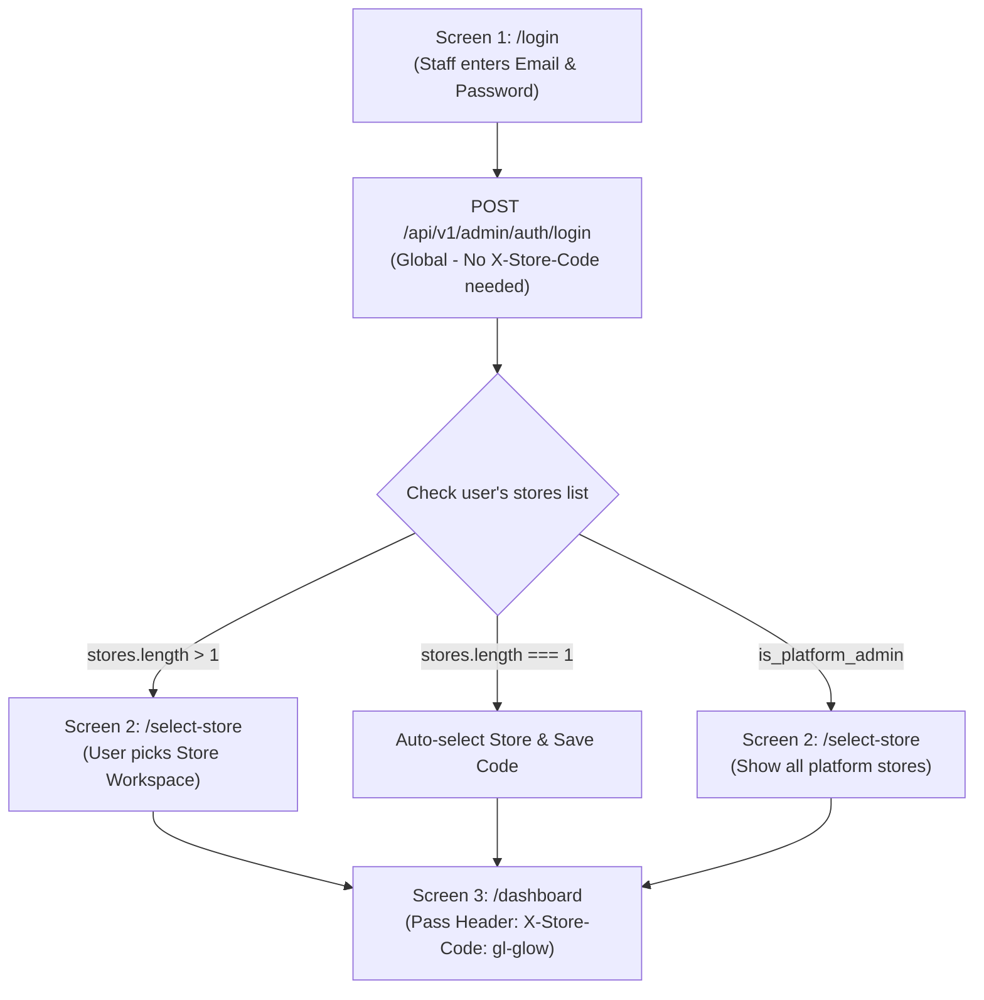

# Admin Panel API & Frontend Integration Guide

> **Project**: GL-Glow Multi-Store E-Commerce Platform  
> **API Version**: `v1`  
> **Target Audience**: Frontend Engineers & UI Developers (React, Next.js, Vue)  
> **Status**: 
> - **Stage 1 (Admin Authentication & Store Memberships)**: **LIVE & TESTED**
> - **Stage 2 (Store Management - Catalog, Orders, Staff)**: **API Contract & Specs**

---

## 1. System Architecture & UI Flow

The backend uses a **Multi-Tenant Global Staff Identity Model**:
* An admin/staff account is global.
* A single staff member can manage **one or multiple stores** with different roles (`store_owner`, `store_manager`, `catalog_manager`, `fulfillment_agent`, `support_agent`).
* **Platform Super Admins** (`is_platform_admin = true`) have universal access to all stores.



---

## 2. Global Request & Response Standards

### 2.1 Base URLs
* **Local Development**: `http://localhost:8000` or `http://127.0.0.1:8000`
* **Tunnel / Staging (Ngrok)**: `https://scant-volumes-flip.ngrok-free.dev`

### 2.2 Standard Request Headers
For every API call made by the frontend, configure your HTTP client (Axios/Fetch) with these headers:

| Header | Required | Description | Example |
|---|---|---|---|
| `Accept` | **Yes** | Must always be JSON | `application/json` |
| `Content-Type` | **Yes** (on POST/PUT/PATCH) | Request payload format | `application/json` |
| `Authorization` | **Yes** (Protected routes) | Sanctum Bearer token | `Bearer 1\|qX8zK...` |
| `X-Store-Code` | **Yes** (For store-scoped APIs) | Slug of the currently selected store | `gl-glow` |
| `ngrok-skip-browser-warning` | Optional (Ngrok only) | Bypasses free ngrok warning page | `true` |

### 2.3 Unified Response Envelope

#### Successful Response (`200 OK` / `201 Created`):
```json
{
  "success": true,
  "data": { ... }
}
```

#### Error Response:
```json
{
  "success": false,
  "error": {
    "code": "INVALID_CREDENTIALS",
    "message": "Invalid email or password.",
    "details": { ... }
  }
}
```

### 2.4 Common HTTP Status Codes
* `200 OK`: Request succeeded.
* `201 Created`: Resource successfully created.
* `401 Unauthorized`: Missing or invalid token (`UNAUTHENTICATED` / `INVALID_CREDENTIALS`). Frontend should redirect to `/login`.
* `403 Forbidden`: Account is inactive (`ACCOUNT_INACTIVE`), or token lacks admin ability (`FORBIDDEN_SCOPE`), or staff does not belong to the requested store (`STORE_MISMATCH`).
* `404 Not Found`: Store not found or resource does not exist.
* `422 Unprocessable Entity`: Validation failure. Errors are in `error.details`.
* `429 Too Many Requests`: Rate limiter triggered. Header `Retry-After: <seconds>` is sent.

---

## 3. Module 1: Admin Authentication (LIVE)

These endpoints are live on the backend right now.

### 3.1 Staff Login
Authenticates administrative staff credentials globally (independent of store codes) and returns the Bearer token plus the staff member's authorized stores.

* **Endpoint**: `POST /api/v1/admin/auth/login`
* **Auth Required**: No
* **Store Header Required**: No
* **Request Body**:
  ```json
  {
    "email": "admin@example.com",
    "password": "Password123!"
  }
  ```

#### Success Response (`200 OK`):
```json
{
  "success": true,
  "data": {
    "token": "1|2BvYc7u9N...plainTextToken...",
    "token_type": "Bearer",
    "staff": {
      "id": 1,
      "first_name": "Eleanor",
      "last_name": "Vance",
      "full_name": "Eleanor Vance",
      "email": "admin@example.com",
      "is_platform_admin": false,
      "is_active": true,
      "created_at": "2026-10-19T10:00:00.000000Z"
    },
    "stores": [
      {
        "store_id": 1,
        "store_code": "gl-glow",
        "store_name": "GL Glow Store",
        "default_currency": "USD",
        "role": "store_owner",
        "is_active": true
      },
      {
        "store_id": 2,
        "store_code": "luxe-fragrance",
        "store_name": "Luxe Fragrance Boutique",
        "default_currency": "EUR",
        "role": "catalog_manager",
        "is_active": true
      }
    ],
    "can_access_all_stores": false
  }
}
```

#### Rate Limiting:
* Max **5 failed attempts** per email/IP in 60 seconds.
* Max **20 failed attempts** globally per IP in 60 seconds.
* Error `429 Too Many Requests` returns `Retry-After: 52`.

---

### 3.2 Get Current Profile (`/me`)
Retrieves the logged-in staff member's profile and refreshes their store membership list. Use this on app initialization / page refresh.

* **Endpoint**: `GET /api/v1/admin/auth/me`
* **Auth Required**: `Bearer <token>`
* **Store Header Required**: No

#### Success Response (`200 OK`):
```json
{
  "success": true,
  "data": {
    "staff": {
      "id": 1,
      "first_name": "Eleanor",
      "last_name": "Vance",
      "full_name": "Eleanor Vance",
      "email": "admin@example.com",
      "is_platform_admin": false,
      "is_active": true,
      "created_at": "2026-10-19T10:00:00.000000Z"
    },
    "stores": [
      {
        "store_id": 1,
        "store_code": "gl-glow",
        "store_name": "GL Glow Store",
        "default_currency": "USD",
        "role": "store_owner",
        "is_active": true
      }
    ],
    "can_access_all_stores": false
  }
}
```

---

### 3.3 Staff Logout
Revokes **only** the token used in the current session.

* **Endpoint**: `POST /api/v1/admin/auth/logout`
* **Auth Required**: `Bearer <token>`
* **Store Header Required**: No

#### Success Response (`200 OK`):
```json
{
  "success": true,
  "data": {
    "message": "Successfully logged out."
  }
}
```

---

## 4. Module 2: Media & AWS S3 File Uploads (LIVE)

For uploading product pictures, category banners, or staff/customer avatars directly to AWS S3:

### 4.1 Upload Media to AWS S3
Uploads an image file to the `age-ai` S3 bucket in `us-east-2` and immediately returns its permanent public URL.

* **Endpoint**: `POST /api/v1/admin/media/upload`
* **Auth Required**: `Bearer <admin_token>`
* **Store Header Required**: No
* **Content-Type**: `multipart/form-data`
* **Form-Data Fields**:
  * `file` (File, Required): Image file (`jpeg, png, jpg, webp, gif, svg`, max 10MB).
  * `folder` (String, Optional): Storage directory: `products`, `categories`, `avatars`, `banners`, `general`. Default: `products`.

#### Success Response (`201 Created`):
```json
{
  "success": true,
  "data": {
    "url": "https://age-ai.s3.us-east-2.amazonaws.com/products/9eba477b-2a49-4a63-9894-1cac60e0bae5.webp",
    "path": "products/9eba477b-2a49-4a63-9894-1cac60e0bae5.webp",
    "filename": "9eba477b-2a49-4a63-9894-1cac60e0bae5.webp",
    "original_name": "rose-serum.webp",
    "mime_type": "image/webp",
    "size_bytes": 145230
  }
}
```

> **Integration Pattern for Forms (Products / Profiles)**:
> 1. When the admin selects an image in the UI, the frontend immediately posts the file to `/api/v1/admin/media/upload`.
> 2. The endpoint returns the public S3 URL (`data.url`).
> 3. The frontend displays the live image preview using this URL.
> 4. When submitting the main Product or Profile form, the frontend simply passes this `url` in `image_url` or `images: [url1, url2]`.
> 5. The backend stores the URL in PostgreSQL.

---

### 4.2 Delete Media from AWS S3
Deletes an unused or replaced image from S3.

* **Endpoint**: `DELETE /api/v1/admin/media`
* **Auth Required**: `Bearer <admin_token>`
* **Request Body**:
  ```json
  {
    "url": "https://age-ai.s3.us-east-2.amazonaws.com/products/9eba477b-2a49-4a63-9894-1cac60e0bae5.webp"
  }
  ```

#### Success Response (`200 OK`):
```json
{
  "success": true,
  "data": {
    "deleted": true,
    "message": "Media file deleted successfully from S3."
  }
}
```

---

## 5. Module 3: Store Catalog Management (Stage 2 Contract)

All endpoints in this section require:
1. `Authorization: Bearer <admin_token>`
2. `X-Store-Code: <current_store_code>`

### 4.1 List Products
* **Endpoint**: `GET /api/v1/admin/products`
* **Query Parameters**:
  * `page` (integer, default: `1`)
  * `per_page` (integer, default: `15`, max: `100`)
  * `category_id` (integer, optional)
  * `status` (string, optional: `active`, `inactive`)
  * `search` (string, optional: search in product name, SKU)
  * `sort` (string, optional: `name`, `price_asc`, `price_desc`, `newest`)

#### Success Response (`200 OK`):
```json
{
  "success": true,
  "data": [
    {
      "id": 10,
      "category_id": 1,
      "category_name": "Skincare",
      "name": "Botanical Radiance Serum",
      "slug": "botanical-radiance-serum",
      "sku": "GL-SRM-001",
      "price_minor": 4800,
      "compare_at_price_minor": 6000,
      "price_formatted": "$48.00",
      "compare_at_price_formatted": "$60.00",
      "stock_quantity": 45,
      "is_in_stock": true,
      "is_active": true,
      "is_featured": true,
      "image_url": "https://images.unsplash.com/photo-1620916566398-39f1143ab7be",
      "created_at": "2026-10-16T19:27:48+00:00"
    }
  ],
  "meta": {
    "current_page": 1,
    "last_page": 5,
    "per_page": 15,
    "total": 68
  }
}
```

---

### 4.2 Create Product
* **Endpoint**: `POST /api/v1/admin/products`
* **Request Body**:
  ```json
  {
    "category_id": 1,
    "name": "Vitamin C Glow Cream",
    "slug": "vitamin-c-glow-cream",
    "description": "Nourishing daily moisturizer with 10% Vitamin C.",
    "sku": "GL-CRM-002",
    "price_minor": 3500,
    "compare_at_price_minor": 4500,
    "stock_quantity": 80,
    "is_active": true,
    "is_featured": false,
    "image_url": "https://example.com/cream.jpg",
    "images": [
      "https://example.com/cream-1.jpg",
      "https://example.com/cream-2.jpg"
    ],
    "custom_attributes": {
      "skin_type": "All skin types",
      "volume_ml": 50
    }
  }
  ```

#### Success Response (`201 Created`):
```json
{
  "success": true,
  "data": {
    "id": 11,
    "name": "Vitamin C Glow Cream",
    "sku": "GL-CRM-002",
    "price_minor": 3500,
    "stock_quantity": 80,
    "is_active": true,
    "created_at": "2026-10-20T02:00:00Z"
  }
}
```

---

### 4.3 Update Product
* **Endpoint**: `PUT /api/v1/admin/products/{id}` or `PATCH /api/v1/admin/products/{id}`
* **Request Body**: Partial or full fields (e.g. updating stock or price):
  ```json
  {
    "stock_quantity": 95,
    "price_minor": 3200,
    "is_active": true
  }
  ```

#### Success Response (`200 OK`):
```json
{
  "success": true,
  "data": {
    "id": 11,
    "stock_quantity": 95,
    "price_minor": 3200,
    "updated_at": "2026-10-20T02:15:00Z"
  }
}
```

---

### 4.4 Delete Product
* **Endpoint**: `DELETE /api/v1/admin/products/{id}`
* Performs a soft delete to protect historical order records.

#### Success Response (`200 OK`):
```json
{
  "success": true,
  "data": {
    "message": "Product successfully deleted."
  }
}
```

---

### 4.5 Categories Management
* **List Categories**: `GET /api/v1/admin/categories`
* **Create Category**: `POST /api/v1/admin/categories`
  ```json
  {
    "name": "Face Masks",
    "slug": "face-masks",
    "description": "Hydrating and clay sheet masks.",
    "parent_id": 1,
    "sort_order": 3,
    "is_active": true
  }
  ```
* **Update Category**: `PUT /api/v1/admin/categories/{id}`
* **Delete Category**: `DELETE /api/v1/admin/categories/{id}`

---

## 5. Module 3: Orders & Fulfillment (Stage 2 Contract)

### 5.1 List Store Orders
* **Endpoint**: `GET /api/v1/admin/orders`
* **Query Parameters**:
  * `page`, `per_page`
  * `status`: `pending`, `confirmed`, `processing`, `shipped`, `delivered`, `cancelled`
  * `payment_status`: `pending`, `paid`, `failed`, `refunded`
  * `search`: Order number or customer email

#### Success Response (`200 OK`):
```json
{
  "success": true,
  "data": [
    {
      "id": 105,
      "order_number": "ORD-20261019-9482",
      "customer_email": "jane.doe@example.com",
      "total_minor": 9600,
      "currency": "USD",
      "total_formatted": "$96.00",
      "status": "processing",
      "payment_status": "paid",
      "items_count": 2,
      "created_at": "2026-10-19T14:30:00Z"
    }
  ],
  "meta": {
    "current_page": 1,
    "last_page": 8,
    "total": 120
  }
}
```

---

### 5.2 Order Detail
* **Endpoint**: `GET /api/v1/admin/orders/{order_number}`

#### Success Response (`200 OK`):
```json
{
  "success": true,
  "data": {
    "order_number": "ORD-20261019-9482",
    "status": "processing",
    "payment_status": "paid",
    "subtotal_minor": 9000,
    "tax_minor": 600,
    "shipping_minor": 0,
    "total_minor": 9600,
    "currency": "USD",
    "customer": {
      "id": 14,
      "name": "Jane Doe",
      "email": "jane.doe@example.com",
      "phone": "+1 (555) 234-5678"
    },
    "shipping_address": {
      "address_line1": "742 Evergreen Terrace",
      "city": "Springfield",
      "state": "IL",
      "postal_code": "62704",
      "country": "US"
    },
    "items": [
      {
        "product_id": 10,
        "product_name": "Botanical Radiance Serum",
        "sku": "GL-SRM-001",
        "quantity": 2,
        "unit_price_minor": 4500,
        "subtotal_minor": 9000
      }
    ],
    "timeline": [
      { "status": "pending", "timestamp": "2026-10-19T14:30:00Z" },
      { "status": "paid", "timestamp": "2026-10-19T14:31:15Z" },
      { "status": "processing", "timestamp": "2026-10-19T15:00:00Z" }
    ]
  }
}
```

---

### 5.3 Update Fulfillment Status
* **Endpoint**: `PATCH /api/v1/admin/orders/{order_number}/status`
* **Request Body**:
  ```json
  {
    "status": "shipped",
    "tracking_number": "TRK987654321US",
    "carrier": "FedEx",
    "notes": "Dispatched via FedEx Express"
  }
  ```

---

## 6. Frontend Integration Blueprint (Ready to Copy)

### 6.1 TypeScript Interfaces

```typescript
// types/admin.ts

export interface StaffUser {
  id: number;
  first_name: string;
  last_name: string;
  full_name: string;
  email: string;
  is_platform_admin: boolean;
  is_active: boolean;
  created_at: string;
}

export type StaffRole = 
  | 'store_owner' 
  | 'store_manager' 
  | 'catalog_manager' 
  | 'fulfillment_agent' 
  | 'support_agent';

export interface StoreMembership {
  store_id: number;
  store_code: string;
  store_name: string;
  default_currency: string;
  role: StaffRole;
  is_active: boolean;
}

export interface AdminLoginResponse {
  token: string;
  token_type: 'Bearer';
  staff: StaffUser;
  stores: StoreMembership[];
  can_access_all_stores: boolean;
}

export interface ApiResponse<T> {
  success: boolean;
  data: T;
  error?: {
    code: string;
    message: string;
    details?: Record<string, string[]>;
  };
}
```

---

### 6.2 Pre-Configured Axios Client

```typescript
// lib/adminApiClient.ts
import axios from 'axios';

const adminApiClient = axios.create({
  baseURL: process.env.NEXT_PUBLIC_ADMIN_API_URL || 'https://scant-volumes-flip.ngrok-free.dev/api/v1',
  headers: {
    'Accept': 'application/json',
    'Content-Type': 'application/json',
    'ngrok-skip-browser-warning': 'true', // Needed if hitting via free ngrok tunnel
  },
  withCredentials: true,
});

// Request Interceptor: Injects token and current active store
adminApiClient.interceptors.request.use((config) => {
  if (typeof window !== 'undefined') {
    const token = localStorage.getItem('admin_token');
    const storeCode = localStorage.getItem('active_store_code');

    if (token) {
      config.headers.Authorization = `Bearer ${token}`;
    }

    // Include store code for all non-global routes
    if (storeCode && !config.url?.includes('/admin/auth/')) {
      config.headers['X-Store-Code'] = storeCode;
    }
  }
  return config;
});

// Response Interceptor: Centralized 401 & 403 handling
adminApiClient.interceptors.response.use(
  (response) => response,
  (error) => {
    if (error.response?.status === 401) {
      // Clear token and bounce to login
      localStorage.removeItem('admin_token');
      localStorage.removeItem('active_store_code');
      if (typeof window !== 'undefined' && !window.location.pathname.includes('/login')) {
        window.location.href = '/login';
      }
    }
    return Promise.reject(error);
  }
);

export default adminApiClient;
```

---

### 6.3 Recommended Admin UI Route Structure

| Route | Purpose | Access Rule |
|---|---|---|
| `/login` | Staff email & password login form | Public (redirects to `/dashboard` if already logged in) |
| `/select-store` | Workspace switcher (cards showing store name & assigned role) | Protected (if user has > 1 store) |
| `/dashboard` | Primary admin metrics (orders, revenue, low stock) | Protected + requires active store selected |
| `/products` | Catalog table with search, category filters, and active toggle | Protected (`catalog_manager` or above) |
| `/products/new` | Product creation wizard | Protected |
| `/products/[id]/edit` | Edit product, pricing, and images | Protected |
| `/orders` | Order processing queue with status tabs (Processing, Shipped) | Protected (`fulfillment_agent` or above) |
| `/orders/[orderNumber]` | Order details, customer address, line items, and fulfillment modal | Protected |
| `/customers` | Store customer database & spending history | Protected (`store_manager` or above) |
| `/settings/team` | Manage staff memberships and roles for this store | Protected (`store_owner` or platform admin) |
